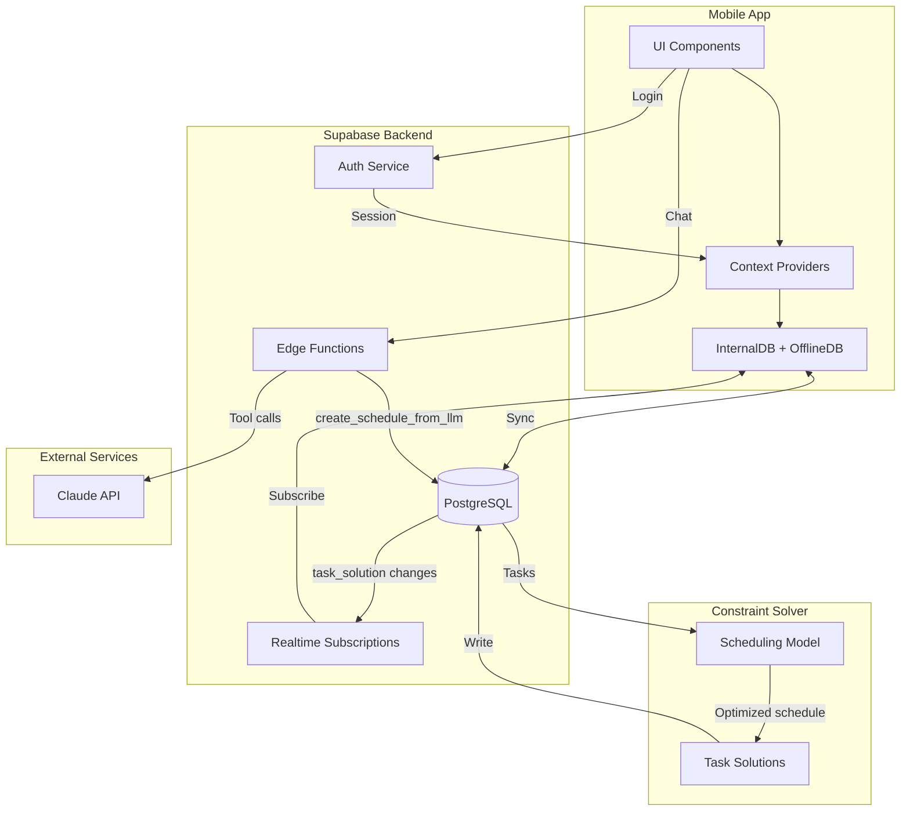
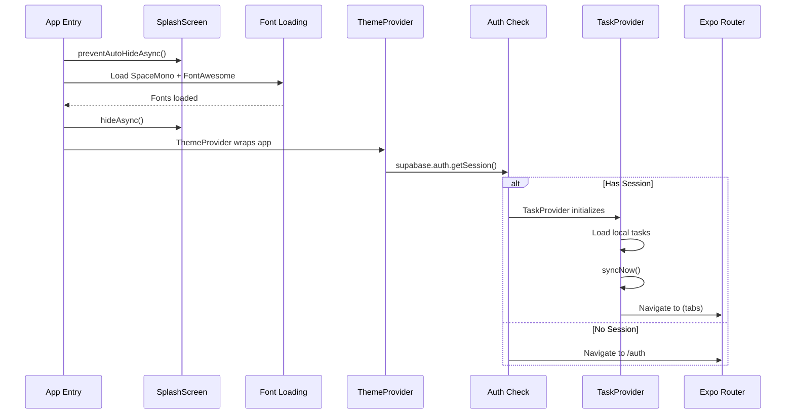
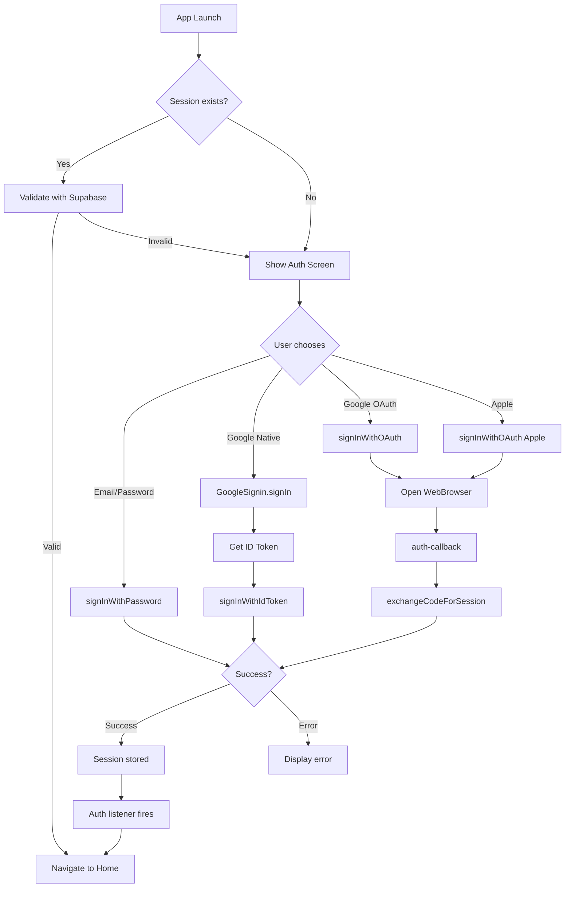
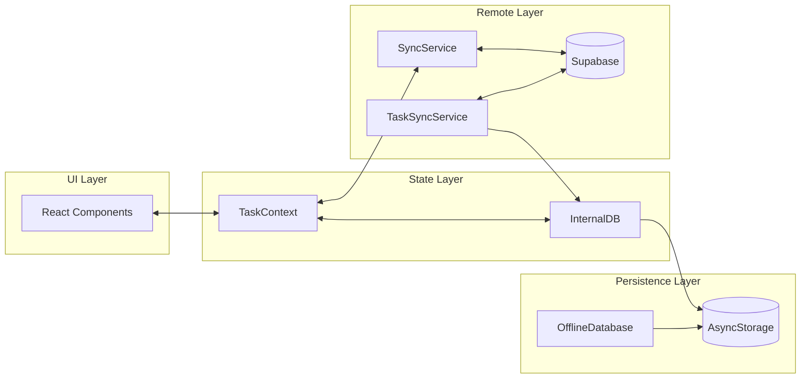
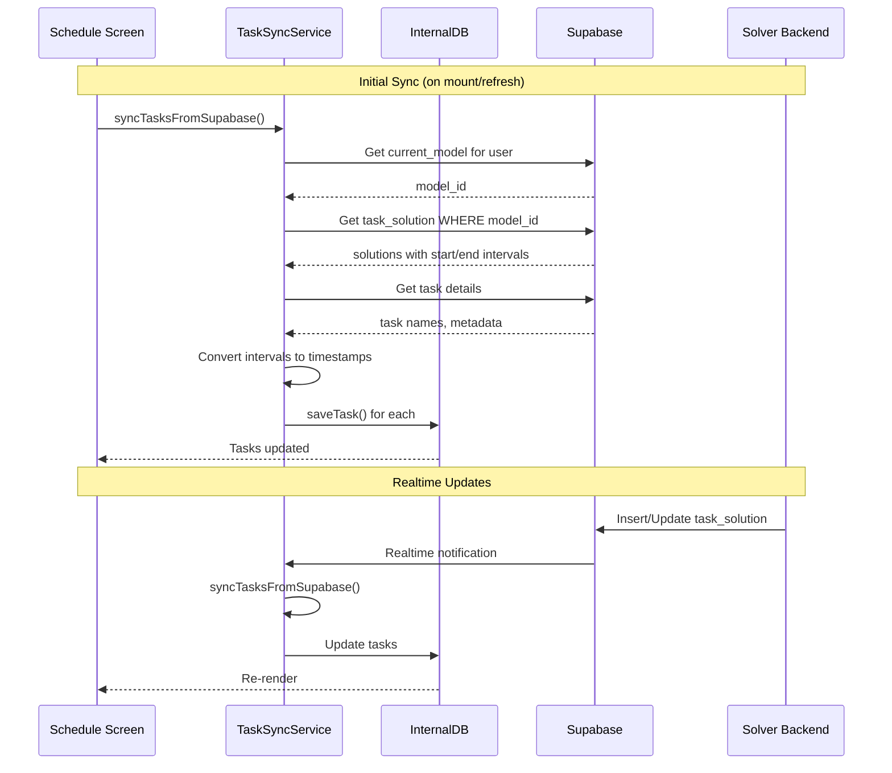
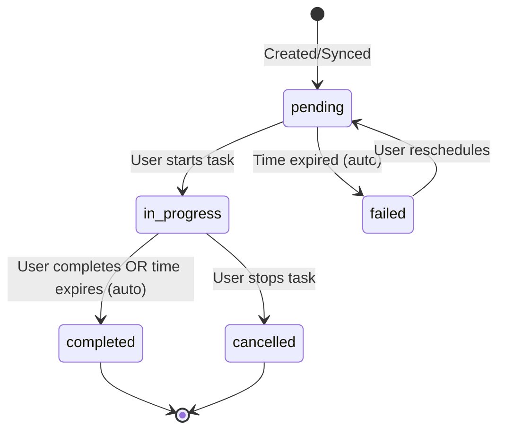
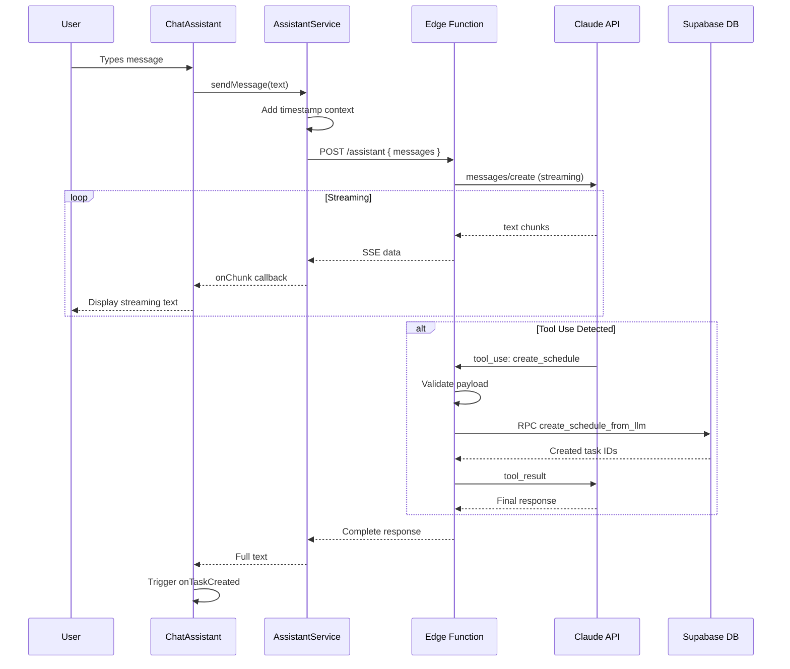

# SkedAI Mobile App Documentation

> **Audience**: Developers maintaining or extending the SkedAI mobile codebase  
> **Last Updated**: January 2026

---

## What is SkedAI?

SkedAI is a smart scheduling app that helps users manage their tasks. What makes it special is that it uses an AI-powered "solver" that automatically figures out the best times to schedule tasks based on constraints (like "I need to do this after 9am" or "this takes 2 hours").

**The mobile app is the user-facing part** - it's where users see their schedule, start/complete tasks, and chat with an AI assistant to create new tasks using natural language.

**Think of the architecture like this:**
- **Mobile App** (this codebase): The interface users interact with
- **Supabase**: The database and authentication system in the cloud
- **Solver**: A separate backend service that figures out optimal schedules
- **Claude AI**: Powers the chat assistant for natural language task creation

The mobile app talks to all these services and keeps everything in sync, even when the user is offline.

---

## Table of Contents

1. [Quick Reference](#1-quick-reference)
2. [Architecture Overview](#2-architecture-overview)
3. [Application Lifecycle](#3-application-lifecycle)
4. [Authentication System](#4-authentication-system)
5. [Navigation Structure](#5-navigation-structure)
6. [Data Management Architecture](#6-data-management-architecture)
7. [Supabase Integration](#7-supabase-integration)
8. [Task Sync Service](#8-task-sync-service)
9. [Schedule Screen Deep Dive](#9-schedule-screen-deep-dive)
10. [LLM Assistant Integration](#10-llm-assistant-integration)
11. [State Management](#11-state-management)
12. [Theming & UI Components](#12-theming--ui-components)
13. [Notifications](#13-notifications)

---

## 1. Quick Reference

This section is your cheat sheet. When you need to quickly find where something lives or what technology we use, start here.

### Tech Stack

| Technology | Version | Purpose |
|------------|---------|---------|
| React Native | 0.79.2 | Cross-platform mobile framework |
| Expo SDK | 53 | Development tooling & native APIs |
| TypeScript | Strict mode | Type safety |
| Expo Router | v5 | File-based navigation |
| Supabase | Latest | Backend (Auth, DB, Realtime) |
| AsyncStorage | Latest | Local persistence |

### Key Entry Points

| File | Purpose |
|------|---------|
| `app/_layout.tsx` | Root layout, auth guard, provider setup |
| `app/(tabs)/_layout.tsx` | Tab navigation configuration |
| `app/(tabs)/schedule.tsx` | Main task view screen |
| `app/auth.tsx` | Authentication screen |
| `lib/supabase.ts` | Supabase client configuration |
| `contexts/TaskContext.tsx` | Global task state management |

### Project Structure

```
src/
├── app/                    # Expo Router screens
│   ├── _layout.tsx         # Root layout with auth
│   ├── (tabs)/             # Tab screens
│   │   ├── _layout.tsx     # Tab configuration
│   │   ├── index.tsx       # Home screen
│   │   ├── schedule.tsx    # Task view (main screen)
│   │   ├── scheduled-tasks.tsx
│   │   ├── calendar.tsx
│   │   ├── dev.tsx         # Developer tools
│   │   └── settings.tsx
│   ├── auth.tsx            # Login/signup
│   └── auth-callback.tsx   # OAuth callback
├── components/             # Reusable UI components
│   ├── ChatAssistant.tsx   # LLM chat interface
│   ├── GlassMorphism.tsx   # Glass effect wrapper
│   ├── ThemedGradient.tsx  # Themed backgrounds
│   └── ColorLabelPicker.tsx
├── contexts/               # React Context providers
│   ├── TaskContext.tsx     # Task state & operations
│   └── ThemeContext.tsx    # Theme management
├── lib/                    # Core services
│   ├── supabase.ts         # Supabase client
│   ├── storage.ts          # Safe AsyncStorage wrapper
│   ├── internal-db.ts      # Local task database
│   ├── offline/            # Offline-first sync
│   │   ├── database.ts     # Task persistence
│   │   └── sync.ts         # Bidirectional sync
│   ├── sync/
│   │   └── TaskSyncService.ts  # Solver sync
│   ├── llm/                # AI assistant
│   │   ├── AssistantService.ts
│   │   ├── config.ts
│   │   └── featureFlags.ts
│   └── notifications/
│       └── service.ts      # Push notifications
├── constants/
│   ├── Colors.ts           # Theme colors
│   └── ColorLabels.ts      # Task color labels
└── config/
    └── constants.ts        # App configuration
```

---

## 2. Architecture Overview

**In simple terms:** The app has three main jobs:
1. **Show the user their schedule** - Display tasks, timers, and let them interact
2. **Keep data in sync** - Make sure what's on the phone matches what's in the cloud
3. **Work offline** - Let users do things even without internet, then sync later

The app doesn't figure out *when* to schedule tasks - that's the solver's job. The app just displays what the solver decides and lets users interact with it.

### High-Level Architecture



### Core Design Patterns

These are the main "rules" we follow when building features:

| Pattern | Implementation | Purpose |
|---------|---------------|---------|
| **Offline-First** | AsyncStorage + SyncService | Works without network, syncs when online |
| **Context-Based State** | TaskContext, ThemeContext | Global state without prop drilling |
| **File-Based Routing** | Expo Router v5 | URL-based navigation |
| **Provider Hierarchy** | Nested providers in _layout | Dependency injection |

**What does "Offline-First" mean?** When a user creates or updates a task, we save it locally on their phone *first*, then try to sync it to the cloud. If there's no internet, no problem - it syncs later. This makes the app feel fast and reliable.

**What's "Context-Based State"?** Instead of passing data through every component (prop drilling), we use React Context to make data like tasks and theme settings available anywhere in the app. Think of it like a global variable, but the React way.

### Data Flow Summary

1. **User creates task** → Local InternalDB → Sync to Supabase → Solver processes → Solution written to DB
2. **Solver completes** → Realtime subscription fires → TaskSyncService pulls → InternalDB updated → UI re-renders
3. **User goes offline** → Operations saved locally with `sync_status: 'pending'` → Synced when online

---

## 3. Application Lifecycle

**What happens when someone opens the app?**

When a user taps the app icon, a lot happens in a few seconds:

1. **Splash screen appears** - We show a loading screen while setting up
2. **Load fonts** - Custom fonts need to be loaded before we can use them
3. **Check if user is logged in** - We look for a saved session
4. **If logged in**: Load their tasks from local storage, start syncing with the cloud, show the main screen
5. **If not logged in**: Show the login screen

This all happens in `app/_layout.tsx`, which is the first file that runs.

### App Initialization Sequence



### Provider Hierarchy

```
CustomThemeProvider          ← Theme state (light/dark/system)
  └── ThemeProvider          ← React Navigation theme
      └── TaskProvider       ← Task state & sync (only when authenticated)
          └── Stack          ← Navigation screens
```

### Key Initialization Code

**Root Layout** (`app/_layout.tsx`):
- Loads fonts asynchronously
- Wraps app in `CustomThemeProvider`
- Checks Supabase session on mount
- Subscribes to `onAuthStateChange` for session updates
- Redirects based on auth state:
  - No session + not on auth screen → redirect to `/auth`
  - Has session + on auth screen → redirect to `/(tabs)`

---

## 4. Authentication System

**How do users log in?**

We support multiple ways to sign in:
- **Email/Password** - Traditional username and password
- **Google Sign-In** - "Continue with Google" button
- **Apple Sign-In** - "Continue with Apple" (iOS only)

**Why is auth complicated?** Mobile auth is tricky because:
1. We need to work on iOS, Android, AND web
2. Google Sign-In works differently on native apps vs. web browsers
3. We need to handle "deep links" (when Google/Apple redirects back to our app)
4. Sessions need to persist (so users don't have to log in every time)

All authentication goes through Supabase, which handles the heavy lifting. We just need to get the user's credentials and pass them to Supabase.

### Auth Flow Diagram



### Authentication Methods

| Method | Platform | Implementation |
|--------|----------|----------------|
| Email/Password | All | `supabase.auth.signInWithPassword()` |
| Google (Native) | iOS/Android | `@react-native-google-signin` → `signInWithIdToken()` |
| Google (OAuth) | Web/Expo Go | `signInWithOAuth()` + WebBrowser |
| Apple | iOS | `signInWithOAuth()` + WebBrowser |

### Deep Linking Configuration

- **Scheme**: `skedaiapp://`
- **Callback URL**: `skedaiapp://auth-callback`
- **Bundle ID**: `com.skedai.app`

### Session Persistence

Sessions are persisted via a custom storage adapter in `lib/supabase.ts`:

| Platform | Storage |
|----------|---------|
| Web | `localStorage` |
| Native | `AsyncStorage` via `safeStorage` wrapper |

The `safeStorage` wrapper (`lib/storage.ts`) handles:
- Storage corruption detection
- Automatic recovery attempts
- Graceful error handling

---

## 5. Navigation Structure

**How do users move around the app?**

The app uses a tab bar at the bottom (like most mobile apps). Each tab is a different screen. We use **Expo Router**, which means the file structure directly maps to the navigation structure - if you create a file called `schedule.tsx` in the `(tabs)` folder, it becomes a tab called "schedule".

**Why `(tabs)` has parentheses:** In Expo Router, parentheses create a "group" that doesn't show up in the URL. So `/schedule` works, not `/(tabs)/schedule`.

### Tab Navigation

| Tab | Route | Icon | Purpose |
|-----|-------|------|---------|
| Home | `/(tabs)/index` | `home` | Dashboard overview |
| Task View | `/(tabs)/schedule` | `list` | Main task management screen |
| Today's Tasks | `/(tabs)/scheduled-tasks` | `check-square-o` | Daily task list |
| Calendar | `/(tabs)/calendar` | `calendar` | Calendar view |
| Dev | `/(tabs)/dev` | `wrench` | Developer tools (debug) |
| Settings | `/(tabs)/settings` | `cog` | User preferences |

### Route File Mapping

```
app/
├── _layout.tsx           → Root layout (auth guard)
├── auth.tsx              → /auth
├── auth-callback.tsx     → /auth-callback (OAuth)
├── modal.tsx             → /modal (presentation: modal)
├── (tabs)/
│   ├── _layout.tsx       → Tab bar configuration
│   ├── index.tsx         → /
│   ├── schedule.tsx      → /schedule
│   ├── scheduled-tasks.tsx → /scheduled-tasks
│   ├── calendar.tsx      → /calendar
│   ├── dev.tsx           → /dev
│   └── settings.tsx      → /settings
└── +not-found.tsx        → 404 fallback
```

---

## 6. Data Management Architecture

**Where does task data live?**

This is one of the most important parts to understand. Task data exists in THREE places:

1. **On the phone (InternalDB)** - The "source of truth" for the UI. When you see tasks on screen, they come from here.
2. **In the cloud (Supabase)** - The permanent storage. This is where tasks live long-term and get processed by the solver.
3. **In transit (SyncService)** - The code that moves data between phone and cloud.

**Why three places?** 
- Phone storage makes the app fast and offline-capable
- Cloud storage makes data persistent and shareable
- The sync layer handles conflicts and keeps them in sync

**A common confusion:** There are actually TWO local databases - `InternalDB` and `OfflineDatabase`. They serve slightly different purposes:
- **InternalDB**: Used by the schedule screen, optimized for display
- **OfflineDatabase**: Used by the sync system, tracks sync status

Think of InternalDB as "what to show" and OfflineDatabase as "what to sync".

### Three-Tier Storage System



### Data Models

**InternalTask** (`lib/internal-db.ts`):

```typescript
interface InternalTask {
  id: string              // Unique identifier
  name: string            // Task name
  start_time: string      // ISO string
  end_time: string        // ISO string
  duration: number        // Duration in seconds
  status: 'pending' | 'in_progress' | 'completed' | 'paused' | 'cancelled' | 'failed'
  priority: 'low' | 'medium' | 'high'
  colorLabel?: ColorLabelKey  // Task categorization
  completed_at?: string
  created_at: string
  updated_at: string
}
```

**Task** (`lib/offline/database.ts`):

```typescript
interface Task {
  id: string
  task_id?: string        // Supabase ID
  local_id: string        // Local ID for offline
  user_id: string
  name: string
  task_json?: any         // Additional task data
  status: 'pending' | 'completed' | 'in_progress' | 'created' | 'failed'
  start_time?: string
  end_time?: string
  due_at?: string
  reminder_at?: string
  priority: 'low' | 'medium' | 'high'
  sync_status: 'synced' | 'pending' | 'conflict'
  created_at: string
  updated_at: string
  deleted_at?: string     // Soft delete
}
```

### AsyncStorage Keys

| Key | Purpose | Used By |
|-----|---------|---------|
| `@skedai_tasks` | Task array | OfflineDatabase |
| `@skedai_sync_metadata` | Last sync time, pending count | OfflineDatabase |
| `@skedai_sync_queue` | Tasks awaiting sync | OfflineDatabase |
| `internal_tasks` | Local task state | InternalDB |
| `internal_actions` | User action history | InternalDB |
| `internal_deleted_tasks` | Deleted task IDs (prevent re-sync) | InternalDB |
| `@app_theme` | Theme preference | ThemeContext |

---

## 7. Supabase Integration

**What is Supabase?**

Supabase is our "backend as a service" - it gives us:
- **A PostgreSQL database** - Where all our data lives
- **Authentication** - Handles login, sessions, OAuth
- **Realtime subscriptions** - Push notifications when data changes
- **Edge Functions** - Serverless code that runs in the cloud

**Why Supabase?** We don't have to build and maintain our own backend servers. Supabase handles scaling, security, and infrastructure.

**The mobile app connects to Supabase for:**
1. Logging users in/out
2. Fetching task data
3. Creating tasks (via the LLM)
4. Receiving realtime updates when the solver finishes

### Client Configuration

**File**: `lib/supabase.ts`

```typescript
const supabaseUrl = 'https://jfcurpgmlzlceotuthat.supabase.co'
const supabaseAnonKey = '...'

export const supabase = createClient(supabaseUrl, supabaseAnonKey, {
  auth: {
    storage: customStorage,      // AsyncStorage adapter
    autoRefreshToken: true,
    persistSession: true,
    detectSessionInUrl: false,
    flowType: 'pkce',            // Secure auth flow
  },
  global: {
    fetch: customFetchWithTimeout,  // 30s timeout
  },
})
```

### Database Tables Used

| Table | Purpose | Mobile Usage |
|-------|---------|--------------|
| `task` | Core task definitions | Create via LLM, read for display |
| `task_solution` | Solver-generated schedules | Read start/end times |
| `current_model` | User's active scheduling model | Find which model to query |
| `model` | Scheduling model metadata | Fallback model lookup |
| `entity` | People/objects for tasks | Referenced by LLM |
| `user_place_location` | Saved locations | Referenced by LLM |
| `user` | User profiles | Auth integration |

### RPC Functions

| Function | Purpose | Parameters |
|----------|---------|------------|
| `create_schedule_from_llm` | Create tasks with entities/locations | `p_payload: { tasks, entities, locations }` |

### Realtime Subscriptions

**TaskSyncService** subscribes to:

```typescript
// Listen for new task solutions from solver
supabase
  .channel('task-solutions-realtime')
  .on('postgres_changes', {
    event: 'INSERT',
    schema: 'public',
    table: 'task_solution',
  }, callback)
  .on('postgres_changes', {
    event: 'UPDATE',
    schema: 'public',
    table: 'task_solution',
  }, callback)
  .subscribe()
```

---

## 8. Task Sync Service

**How do tasks get from the solver to your phone?**

This is the "magic" that makes scheduled tasks appear on the user's screen. Here's what happens:

1. **User creates a task** (via chat or web app)
2. **Task goes to Supabase** database
3. **Solver picks it up**, figures out the best time slot
4. **Solver writes a "solution"** - the scheduled start/end times
5. **Mobile app gets notified** via realtime subscription
6. **TaskSyncService fetches the solution** and updates InternalDB
7. **UI re-renders** with the new scheduled task

**The tricky part: Time conversion**

The solver doesn't store times as normal dates like "2025-01-15T14:00:00". Instead, it uses "interval numbers" - how many 5-minute blocks since January 1, 2020.

For example, interval `525960` means "525,960 five-minute intervals after Jan 1, 2020", which equals a specific date/time.

Why? The solver is optimized for math, not human-readable dates. Our job is to convert these intervals back to real times.

### Sync Flow Diagram



### Epoch-Based Time Conversion

The solver stores times as interval numbers from a reference epoch:

```typescript
const EPOCH = new Date('2020-01-01T00:00:00Z')
const INTERVAL_MS = 5 * 60 * 1000  // 5 minutes

function n2dt(intervalNum: number): string {
  const date = new Date(EPOCH.getTime() + intervalNum * INTERVAL_MS)
  return date.toISOString()
}
```

**Example**: Interval `525960` = `EPOCH + (525960 * 5 minutes)` = Specific datetime

### Deduplication Logic

```typescript
// In syncTasksFromSupabase():

// 1. Track processed task IDs in current sync
const processedTaskIds = new Set<string>()

// 2. Skip if already processed
if (processedTaskIds.has(ts.task_id)) continue

// 3. Skip if user deleted locally
const deletedTaskIds = await internalDB.getDeletedTaskIds()
if (deletedTaskIds.has(ts.task_id)) continue

// 4. Preserve local state when updating
const existingTask = existingTasks.find(t => t.id === ts.task_id)
colorLabel: existingTask?.colorLabel || 'none'
```

### Conflict Resolution

**Strategy**: Last-write-wins with local preference for pending changes

```typescript
// In SyncService.pullChanges():
if (localTask.sync_status === 'pending' && 
    new Date(localTask.updated_at) > new Date(remoteTask.updated_at)) {
  // Local changes are newer, skip remote update
  continue
}
```

---

## 9. Schedule Screen Deep Dive

**The main screen users interact with**

The schedule screen (`app/(tabs)/schedule.tsx`) is where users spend most of their time. It shows:
- What they should be doing RIGHT NOW
- What's coming up next
- A summary of their day (failed/scheduled/completed tasks)

**How it works:**

The screen runs a timer that ticks every second. Each tick, it checks:
- Is there a task running? Show the countdown timer.
- Is a task about to start (within 5 minutes)? Show "Ready to Start" prompt.
- Did a running task's time expire? Auto-complete it.

**Task statuses explained:**
- `pending` - Scheduled but not started yet
- `in_progress` - User clicked "Start", timer is running
- `completed` - Task finished (manually or automatically)
- `failed` - Task was missed and couldn't be rescheduled
- `cancelled` - User manually stopped the task

### UI Sections

The schedule screen (`app/(tabs)/schedule.tsx`) displays tasks in sections:

| Section | Condition | Purpose |
|---------|-----------|---------|
| **Ready to Start** | `status !== 'in_progress'` AND within half-granularity of start | Prompt user to begin task |
| **Now** | `status === 'in_progress'` AND within time window | Currently running task with timer |
| **Free Time** | No running task | Shows countdown to next task |
| **Next Up** | First upcoming task | Preview of what's next |
| **Task Overview** | Always shown | Summary cards (Failed/Scheduled/Completed) |
| **Task Lists** | Grouped by status | Failed, Scheduled, Completed sections |

### Task Status Lifecycle



### Auto-Complete/Fail Logic

```typescript
// Every second, check tasks:
for (const task of tasksWithTimes) {
  const now = currentTime.getTime()
  const taskEnd = new Date(task.end_time).getTime()
  
  if (task.status === 'in_progress' && now > taskEnd) {
    // Auto-complete expired in-progress tasks
    await internalDB.updateTask(task.local_id, { 
      status: 'completed',
      completed_at: new Date().toISOString()
    })
  }
  // Note: Pending tasks are NOT auto-failed locally
  // Server handles rescheduling via refresh_models
}
```

### Task Granularity

```typescript
const TASK_GRANULARITY = 600      // 10 minutes in seconds
const HALF_GRANULARITY = 300      // 5 minutes

// Task is "ready to start" when:
const timeUntilStart = taskStart - now
return timeUntilStart <= HALF_GRANULARITY * 1000  // Within 5 minutes
```

### Color Labels System

Tasks can have color labels for categorization:

| Label Key | Color | Name |
|-----------|-------|------|
| `none` | Default | No label |
| `red` | #EF5350 | Red |
| `orange` | #FFA726 | Orange |
| `yellow` | #FFEE58 | Yellow |
| `green` | #66BB6A | Green |
| `blue` | #42A5F5 | Blue |
| `purple` | #AB47BC | Purple |

---

## 10. LLM Assistant Integration

**How does the AI chat work?**

Users can type natural language like "Schedule a meeting with John tomorrow at 2pm" and the app creates the task automatically. Here's how:

1. **User types a message** in the ChatAssistant component
2. **Message goes to a Supabase Edge Function** (serverless code in the cloud)
3. **Edge Function calls Claude AI** (Anthropic's language model)
4. **Claude understands the request** and decides what "tools" to use
5. **If Claude wants to create a task**, it calls the `create_schedule` tool
6. **Edge Function creates the task** in Supabase via an RPC function
7. **Response streams back** to the user in real-time (like ChatGPT)

**Why use an Edge Function?** We can't call Claude directly from the mobile app because:
- API keys would be exposed in the app bundle
- We need server-side validation before creating tasks
- The Edge Function can access the database directly

**What's "streaming"?** Instead of waiting for the entire response, we show text as it's generated - character by character. This makes the chat feel responsive.

### Request Flow



### Tool Definition

The assistant has access to the `create_schedule` tool:

```typescript
{
  name: 'create_schedule',
  description: 'Create tasks with entities, locations, and constraints',
  input_schema: {
    type: 'object',
    properties: {
      tasks: {
        type: 'array',
        items: {
          name: string,           // Required
          description?: string,
          priority?: 'optional' | 'low' | 'normal' | 'high' | 'critical',
          entity_names: string[], // Required - who does the task
          location_name: string,  // Required - where
          constraints: string[],  // e.g., ["duration == 1h", "start_time >= 09:00"]
        }
      },
      entities: [{
        name: string,
        is_person: boolean
      }],
      locations: [{
        name: string,
        address?: string
      }]
    },
    required: ['tasks']
  }
}
```

### Constraint Language Reference

| Attribute | Type | Examples |
|-----------|------|----------|
| `duration` | Duration | `duration == 1h`, `duration >= 30m` |
| `start` | Datetime | `start == 2025-01-15T14:00` |
| `end` | Datetime | `end <= 2025-01-15T17:00` |
| `start_time` | Time of day | `start_time >= 09:00` |
| `end_time` | Time of day | `end_time <= 17:00` |
| `temp_c` | Temperature | `temp_c >= 20°C` |
| `is_day` | Boolean | `is_day == true` |

**Operators**: `==`, `!=`, `>=`, `<=`, `>`, `<`, `in`, `between`, `&` (AND), `|` (OR)

### Streaming Response Handling

The `AssistantService` handles both native streaming and fallback parsing:

```typescript
// Try native streaming (response.body.getReader)
if (reader) {
  // Parse SSE events as they arrive
  // Call onChunk for each text delta
}
else {
  // Fallback: Read entire response, parse SSE format
  const text = await response.text()
  return this.parseStreamingText(text, onChunk)
}
```

---

## 11. State Management

**How does data flow through the app?**

We use React Context for global state. Think of it like this:

- **TaskContext** = "Here are all the tasks, and here's how to create/update/delete them"
- **ThemeContext** = "Here's whether we're in light or dark mode"

Any component can access these by calling `useTaskContext()` or `useTheme()`. No need to pass props through 10 layers of components.

**When does state update?**
- User creates/updates/deletes a task → TaskContext updates
- App comes to foreground → TaskContext syncs with server
- Realtime subscription fires → TaskContext refreshes
- User changes theme → ThemeContext updates

### TaskContext API

**File**: `contexts/TaskContext.tsx`

| Property/Method | Type | Description |
|----------------|------|-------------|
| `tasks` | `Task[]` | All active (non-deleted) tasks |
| `loading` | `boolean` | Initial load in progress |
| `syncing` | `boolean` | Sync operation in progress |
| `createTask(task)` | `Promise<Task>` | Create and sync new task |
| `updateTask(localId, updates)` | `Promise<void>` | Update existing task |
| `deleteTask(localId)` | `Promise<void>` | Soft delete task |
| `syncNow()` | `Promise<void>` | Trigger manual sync |
| `refreshTasks()` | `Promise<void>` | Reload from local storage |

**Usage**:

```typescript
import { useTaskContext } from '@/contexts/TaskContext'

function MyComponent() {
  const { tasks, syncing, createTask, syncNow } = useTaskContext()
  
  // Pull-to-refresh
  const onRefresh = async () => {
    await syncNow()
  }
}
```

### ThemeContext API

**File**: `contexts/ThemeContext.tsx`

| Property/Method | Type | Description |
|----------------|------|-------------|
| `theme` | `'light' \| 'dark' \| 'system'` | User's theme preference |
| `actualTheme` | `'light' \| 'dark'` | Resolved theme (after system check) |
| `setTheme(theme)` | `void` | Update theme preference |
| `colors` | `typeof Colors.light` | Current color palette |

**Usage**:

```typescript
import { useTheme } from '@/contexts/ThemeContext'

function MyComponent() {
  const { actualTheme, colors, setTheme } = useTheme()
  
  return (
    <View style={{ backgroundColor: colors.background }}>
      <Text style={{ color: colors.text }}>Hello</Text>
    </View>
  )
}
```

### App State Listeners

The `TaskContext` listens for app state changes:

```typescript
// Sync when app comes to foreground
AppState.addEventListener('change', (nextAppState) => {
  if (nextAppState === 'active') {
    syncNow()
  }
})
```

---

## 12. Theming & UI Components

**How does dark mode work?**

The app supports three theme modes:
- **Light** - White backgrounds, dark text
- **Dark** - Dark backgrounds, light text  
- **System** - Follows the phone's setting

When the theme changes, ALL colors in the app update automatically. This works because:
1. We define all colors in `constants/Colors.ts` (both light and dark versions)
2. Components use `useTheme()` to get the current colors
3. When theme changes, React re-renders everything with new colors

**Glass morphism effects**

The app uses "glass" effects - semi-transparent cards with blur. This is done via the `GlassMorphism` component. It's purely visual and makes the UI feel modern.

### Color Palette

**File**: `constants/Colors.ts`

| Token | Light | Dark |
|-------|-------|------|
| `text` | `#000` | `#fff` |
| `textSecondary` | `#666` | `#bbb` |
| `textTertiary` | `#999` | `#888` |
| `background` | `#fff` | `#000` |
| `tint` | `#4A90E2` | `#B19CD9` |
| `cardBackground` | `rgba(255,255,255,0.1)` | `rgba(30,30,30,0.9)` |
| `borderColor` | `#E1E8ED` | `#2D2D3D` |

### Glass Morphism Components

**GlassMorphism** (`components/GlassMorphism.tsx`):

```typescript
<GlassMorphism 
  intensity="light" | "medium" | "strong" | "extra-strong"
  style={customStyles}
  borderRadius={12}
>
  {children}
</GlassMorphism>
```

Creates a frosted glass effect with blur and transparency.

**ThemedGradient** (`components/ThemedGradient.tsx`):

Provides themed gradient backgrounds that adapt to light/dark mode.

### Themed Component Usage

```typescript
import { Text, View } from '@/components/Themed'
import { GlassMorphism } from '@/components/GlassMorphism'
import { ThemedGradient } from '@/components/ThemedGradient'
import ThemedIcon from '@/components/ThemedIcon'

// Themed text automatically uses theme colors
<Text>Automatically themed</Text>

// Glass card
<GlassMorphism intensity="medium">
  <Text>Glass content</Text>
</GlassMorphism>

// Full-screen gradient background
<ThemedGradient style={{ flex: 1 }}>
  {screenContent}
</ThemedGradient>

// Icon with glass effect
<ThemedIcon 
  name="play" 
  size={20} 
  color="#fff"
  glassIntensity="medium"
/>
```

---

## 13. Notifications

**How do push notifications work?**

The app can send notifications to remind users about upcoming tasks. For example:
- "Your meeting starts in 5 minutes"
- "Task due: Submit report"

**Important limitation:** Notifications only work in "development builds", not in Expo Go. This is because push notifications require native code that Expo Go doesn't include.

**To test notifications:**
1. Run `npx expo prebuild --clean`
2. Run `npx expo run:ios` or `npx expo run:android`
3. Now notifications will work

### Overview

Notifications use **Notifee** which requires a native build (not available in Expo Go).

**File**: `lib/notifications/service.ts`

### NotificationService API

| Method | Description |
|--------|-------------|
| `initialize()` | Request permissions, create channel |
| `requestPermissions()` | Request notification permissions |
| `scheduleTaskNotification(task, type)` | Schedule reminder/due/start notification |
| `cancelTaskNotifications(taskLocalId)` | Cancel all notifications for a task |
| `displayNotification(title, body)` | Show immediate notification |
| `scheduleAllNotifications(tasks)` | Batch schedule for all active tasks |

### Notification Types

| Type | Trigger | Title Format |
|------|---------|--------------|
| `reminder` | At `task.reminder_at` | "Reminder: {task.name}" |
| `due` | At `task.due_at` | "Task Due: {task.name}" |
| `start` | Immediate | "Time to Start: {task.name}" |

### Android Channel Configuration

```typescript
await notifee.createChannel({
  id: 'skedai-tasks',
  name: 'Task Notifications',
  importance: AndroidImportance.HIGH,
  sound: 'default',
})
```

### Notification Actions

The `start` notification type includes an action button:

```typescript
actions: [
  {
    title: 'Start Task',
    pressAction: { id: 'start-task', launchActivity: 'default' }
  }
]
```

### Integration with TaskContext

Notifications are automatically managed when tasks change:

```typescript
// On task create
if (newTask.reminder_at) {
  await notificationService.scheduleTaskNotification(newTask, 'reminder')
}

// On task update
await notificationService.cancelTaskNotifications(localId)
// Reschedule if task still active

// On task delete
await notificationService.cancelTaskNotifications(localId)
```

---

## 14. End-to-End Flow: From Chat to Calendar

**The complete journey of a task**

This section walks through EVERYTHING that happens when a user types "Schedule a meeting with John tomorrow at 2pm" in the chat, all the way until it appears on their calendar with a scheduled time.

### Step-by-Step Breakdown


### Step 1: User Types in Chat (Mobile App)

**What happens:**
1. User opens the chat (ChatAssistant component)
2. Types: "Schedule a meeting with John tomorrow at 2pm"
3. Presses send

**Code involved:** `components/ChatAssistant.tsx`

```typescript
// User presses send
const handleSend = async () => {
  const userMessage = inputText.trim()
  setMessages(prev => [...prev, { role: 'user', content: userMessage }])
  
  // Send to LLM service
  await assistantService.sendMessage(userMessage, (chunk) => {
    // Show streaming response
    setStreamingText(prev => prev + chunk)
  })
}
```

---

### Step 2: LLM Processes the Request (Edge Function + Claude)

**What happens:**
1. `AssistantService` sends the message to a Supabase Edge Function
2. Edge Function adds context (current time, timezone, user info)
3. Edge Function calls Claude API with the conversation history
4. Claude understands the request and decides to use the `create_schedule` tool
5. Claude generates a structured payload:

```json
{
  "tasks": [{
    "name": "Meeting with John",
    "entity_names": ["User", "John"],
    "location_name": "Office",
    "constraints": [
      "start == 2025-01-29T14:00",
      "duration == 1h"
    ]
  }],
  "entities": [{ "name": "John", "is_person": true }]
}
```

**Code involved:** `lib/llm/AssistantService.ts`

---

### Step 3: Task Created in Database (Supabase)

**What happens:**
1. Edge Function receives the tool call from Claude
2. Edge Function calls `create_schedule_from_llm` RPC function
3. RPC function does the following IN ORDER:
   - Creates any new entities (John) → `entity` table
   - Creates any new locations (Office) → `user_place_location` table
   - Creates the task → `task` table
   - Links task to entities → `task_entity` table
   - Links task to location → `task_location` table
   - Parses constraints and stores them → `task.definition` field
4. Database triggers fire to mark the user's model as needing re-processing

**Tables affected:**
| Table | What's created |
|-------|----------------|
| `entity` | John (if new) |
| `user_place_location` | Office (if new) |
| `task` | The meeting task |
| `task_entity` | Link between task and John |
| `task_location` | Link between task and Office |
| `scheduled_task` | Scheduling metadata |

**Code involved:** Supabase RPC function `create_schedule_from_llm` (server-side)

---

### Step 4: Solver Calculates Optimal Time (Backend Server)

**What happens:**
1. The solver backend (separate service) detects that the user's model needs processing
2. It loads ALL the user's tasks and constraints
3. It runs a constraint satisfaction algorithm to find the best schedule
4. For our meeting, it confirms "2pm tomorrow" works (no conflicts)
5. It writes the solution to the `task_solution` table:

```json
{
  "task_id": "abc-123",
  "model_id": "model-456", 
  "solution_json": {
    "start": 525960,  // Interval number = 2pm tomorrow
    "end": 525972,    // Interval number = 3pm tomorrow (1 hour later)
    "status": "OPTIMAL"
  }
}
```

**Why interval numbers?** The solver works with discrete time slots (5-minute intervals since Jan 1, 2020). This makes the math easier for optimization.

---

### Step 5: Mobile App Syncs the Solution (TaskSyncService)

**What happens:**
1. Supabase Realtime detects INSERT into `task_solution` table
2. Mobile app's subscription callback fires
3. `TaskSyncService.syncTasksFromSupabase()` runs
4. It fetches the new solution and converts intervals to real times:

```typescript
// Interval 525960 → real datetime
const EPOCH = new Date('2020-01-01T00:00:00Z')
const INTERVAL_MS = 5 * 60 * 1000  // 5 minutes

function n2dt(intervalNum) {
  return new Date(EPOCH.getTime() + intervalNum * INTERVAL_MS).toISOString()
}

// 525960 → "2025-01-29T14:00:00.000Z"
```

5. Task saved to `InternalDB` with real times:

```typescript
{
  id: "abc-123",
  name: "Meeting with John",
  start_time: "2025-01-29T14:00:00.000Z",
  end_time: "2025-01-29T15:00:00.000Z",
  status: "pending",
  colorLabel: "none"
}
```

**Code involved:** `lib/sync/TaskSyncService.ts`

---

### Step 6: Task Appears on Screen (UI Render)

**What happens:**
1. `InternalDB` update triggers a React state update
2. Schedule screen re-renders with the new task
3. Task appears in the appropriate section:
   - If it's far in the future → "Scheduled Tasks" section
   - If it's within 5 minutes → "Ready to Start" section
   - If the user started it → "Now" section with countdown

**Code involved:** `app/(tabs)/schedule.tsx`

```typescript
// Schedule screen loads tasks
const loadInternalTasks = async () => {
  const allInternalTasks = await internalDB.getAllTasks()
  setInternalTasks(allInternalTasks.map(convertInternalTaskToTask))
}

// Tasks are grouped by status
const scheduledTasks = internalTasks.filter(t => t.status === 'pending')
const completedTasks = internalTasks.filter(t => t.status === 'completed')
```

---

### What Can Go Wrong?

| Problem | Symptom | Solution |
|---------|---------|----------|
| LLM doesn't understand | Asks clarifying questions | User provides more details |
| No entity/location match | LLM asks "who/where?" | User specifies or LLM creates new |
| Constraint conflict | Solver can't find time | Task reports back as failed |
| Network offline | Sync fails silently | Task syncs when back online |
| Realtime subscription missed | Task doesn't appear | Pull-to-refresh triggers manual sync |

---

### Debugging This Flow

If a task isn't showing up, check each step:

1. **Chat response** - Did Claude acknowledge creating the task?
2. **Supabase `task` table** - Is the task row there?
3. **Supabase `task_solution` table** - Does a solution exist for the task?
4. **Console logs** - Look for `[TaskSync]` messages
5. **InternalDB** - Call `internalDB.getAllTasks()` in dev tools

```typescript
// Quick debug in React Native Debugger
import { internalDB } from '@/lib/internal-db'
const tasks = await internalDB.getAllTasks()
console.log('Local tasks:', tasks)
```

---

## Appendix: Development Commands

**Quick start:** Run `npm start` in the `src/` folder, then scan the QR code with Expo Go on your phone.

**When to use development builds:** If you need Google Sign-In or notifications, you must use `npx expo run:ios` instead of Expo Go.

```bash
# Start Expo dev server
npm start

# Run on specific platform
npm run ios
npm run android
npm run web

# Create development build (required for native features)
npx expo prebuild --clean
npx expo run:ios
npx expo run:android

# Run tests
npm test
```

## Appendix: Environment Setup

### Required for Native Google Sign-In

1. Xcode 15+ with iOS 17+ Simulator
2. Run `npx expo prebuild --clean`
3. Run `npx expo run:ios`

### Supabase Configuration

- URL: `https://jfcurpgmlzlceotuthat.supabase.co`
- Enable "Skip nonce checks" for native Google Sign-In in Supabase Dashboard

### Deep Linking

Add to `app.json`:

```json
{
  "expo": {
    "scheme": "skedaiapp",
    "ios": {
      "bundleIdentifier": "com.skedai.app"
    }
  }
}
```

---

### Known Issues

#### Task Created But Never Appears on Calendar

**Symptoms:**
- Task created via LLM chat appears in `task` and `scheduled_task` tables
- Model is marked as `processed`
- But `solution` and `task_solution` tables are EMPTY
- Calendar shows no tasks

**Root Cause:**

The solver requires two data connections to calculate a schedule:

1. **Entity's location** - Where the person doing the task currently IS (`entity_location` table)
2. **Task's location** - Where the task will HAPPEN (`user_place_location.location_id`)

When the LLM creates a new location (e.g., "Gym", "Office"), the `create_schedule_from_llm` RPC creates a `user_place_location` record but does NOT set the `location_id` field (it's NULL). 

The solver sees `"locations": {}` in the model data and cannot generate a valid schedule. The task exists in the database but has no solution.

**Workaround:**

When scheduling a task via chat, always end your message with:

> **"SET LOCATION TO HOME"**

Example prompts:
- "Schedule gym tomorrow from 12-1pm. SET LOCATION TO HOME"
- "Add a meeting with John at 3pm on Friday. SET LOCATION TO HOME"

This tells the LLM to use the existing "Home" location record (which has a valid `location_id`) instead of creating a new location with `location_id = NULL`.

**Why this works:**

The "Home" location was manually set up with a valid `location_id` reference. When the LLM finds an existing location by name, it uses that record instead of creating a new one.

**Permanent Fix (requires backend changes):**

The `create_schedule_from_llm` RPC should be updated to:
1. Auto-set `location_id` when creating new `user_place_location` records
2. Ensure new users have an `entity_location` record for their entity

**Diagnosis (if you suspect this issue):**

```sql
-- Check if task's location has a location_id
SELECT name, location_id FROM user_place_location 
WHERE user_id = 'YOUR_USER_ID';
-- If location_id is NULL, that's the problem

-- Check if entity has a location
SELECT * FROM entity_location 
WHERE entity_id = 'YOUR_ENTITY_ID';
-- If no rows, that's also a problem

-- See what the solver sees
SELECT * FROM get_model_data(
  (SELECT model_id FROM current_model WHERE user_id = 'YOUR_USER_ID')
);
-- Look for "locations": {} - empty means solver can't work
```

---

## Appendix: Common Questions (FAQ)

### "Why are there two local databases?"

**InternalDB** and **OfflineDatabase** exist for historical reasons and serve slightly different purposes:
- **InternalDB** is newer, simpler, and used by the schedule screen
- **OfflineDatabase** is older, tracks sync status, and is used by the sync system

You'll mostly work with **InternalDB** when building UI features.

### "Why don't tasks show up after I create them in chat?"

The flow is: Chat → Supabase → Solver → Supabase → Mobile App. If the solver hasn't run yet, the task exists in the database but doesn't have scheduled times. Pull-to-refresh or wait for the realtime subscription to fire.

### "Why does Google Sign-In not work in Expo Go?"

Native Google Sign-In requires custom native code. Expo Go is a pre-built app that can't include our specific Google credentials. Use `npx expo run:ios` to build a development version with native code.

### "What's the difference between `task` and `task_solution` tables?"

- `task` = The task definition (name, constraints, who does it, where)
- `task_solution` = The scheduled time slot (start interval, end interval)

A task can exist without a solution (unscheduled). Once the solver runs, it creates a solution.

### "How do I add a new screen?"

1. Create a new `.tsx` file in `app/(tabs)/` for a tab screen, or `app/` for a standalone screen
2. Export a default React component
3. That's it! Expo Router automatically creates the route

### "Where do I put shared logic?"

- **Reusable UI** → `components/`
- **Data fetching/business logic** → `lib/`
- **Global state** → `contexts/`
- **Constants/config** → `constants/` or `config/`

### "How do I debug sync issues?"

1. Check the console logs - sync operations log extensively
2. Look for `[TaskSync]` prefixed messages
3. Check if `current_model` exists for the user in Supabase
4. Check if `task_solution` has entries for that model_id

